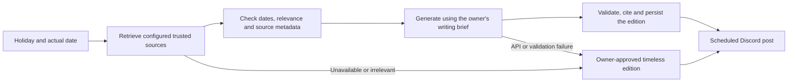

# AI operation, costs and future-year relevance

## If ChatGPT Pro or Codex access ends

**The deployed bot can keep running.** Its Python process runs on your server, and its code remains in your GitHub repository. It does not log in to ChatGPT, borrow your Codex session, or consume a chat subscription.

These are separate components:

| Component | Purpose | What happens if it ends |
| --- | --- | --- |
| ChatGPT/Codex access | Help write, review and maintain code | You lose that development aid; the deployed Python process has no dependency on the session. |
| Hosting | Keep Python/Docker running and preserve SQLite | If the server stops, scheduled posts stop. Same-day catch-up resumes when it returns. |
| Discord bot token | Authenticate the bot to Discord | A revoked/invalid token prevents connection until replaced. |
| AI API account/key/billing | Pay for individual generation requests | AI generation fails; the bot falls back to its saved post content. |
| Optional current-information sources | Supply fresh material | These are not integrated yet. A model alone does not provide dependable current information. |

For hosted OpenAI models, API usage is configured through the API platform, separately from a chat subscription. Do not assume a Pro plan includes your bot's API calls. Check the account's current billing terms directly. API keys belong in secure settings or ignored `.env`, never GitHub or chat.

Official references to consult:

- [ChatGPT versus API platform billing](https://help.openai.com/en/articles/9039756-billing-settings-in-chatgpt-vs-platform)
- [Moving a ChatGPT subscription to the API](https://help.openai.com/en/articles/8156019-how-can-i-move-my-chatgpt-subscription-to-the-api)
- [API pricing](https://openai.com/api/pricing/)

Research note, 31 October 2026: this environment blocked access to external provider sites. These links are references for verification; current plan entitlements, model availability and price figures were not independently checked in this session.

## What the implementation actually does

1. The calendar chooses a holiday and an authored variant or year-specific edition.
2. With `AI_ENABLED=false`, that saved content is used directly.
3. With AI enabled, the request includes the actual post date, Riga timezone, language, holiday, authored post and owner-editable brief.
4. A configured compatible API may rewrite the **introduction only**. The headline, factual section and other authored fields remain unchanged.
5. A successful introduction is cached in SQLite by date, holiday, language and a fingerprint of the model, endpoint, brief and post. The same request after a retry/restart uses the cache without another API call. Editing those inputs invalidates that cache.
6. A timeout, invalid response, unavailable model/key, rejected output or exhausted local budget uses the original saved introduction. The bot continues its normal posting workflow.

The response is checked for basic format/length, not independently fact-checked. Prompts reduce the risk of unsupported claims but cannot prove correctness. Current translation buttons show authored translations; they do not translate the generated introduction. `/svetki test` currently previews authored content, not a live paid AI request.

No chat history, member message content or Discord token is sent to the AI provider. The configured authored post and brief are sent; do not put secrets or private community data in them.

## Configure a provider

OpenAI-style Chat Completions API:

```dotenv
AI_ENABLED=true
AI_BASE_URL=https://api.openai.com/v1
AI_API_KEY=
AI_MODEL=gpt-4o-mini
AI_DAILY_REQUEST_CAP=2
AI_REQUEST_BUDGET_USD=0.01
AI_DAILY_BUDGET_USD=0.02
```

Enter the key securely and choose a model currently offered by the provider. The model shown is the application's existing default, not a guarantee of future availability or a current price recommendation. `OPENAI_API_KEY` is retained as a legacy alias; `AI_API_KEY` takes priority when both are set.

For another provider, change `AI_BASE_URL`, key and model. Compatibility means that it accepts `/chat/completions`, system/user messages and `max_tokens`, and returns `choices[0].message.content`. Not every provider/model supports this interface. HTTPS is required for remote endpoints. Credentials embedded in a URL are rejected. The model name alone does not switch providers.

Restart after changing environment variables. With Docker, recreate the service using `docker compose up -d --force-recreate bot`. Rebuild after changing a bundled writing brief or content file. A cloud environment with restricted networking must also allow the selected API hostname; changing `.env` cannot grant network access.

### Local models

A local model server that implements the same API can be configured without a hosted API subscription. For example, `AI_BASE_URL=http://127.0.0.1:11434/v1` selects a loopback server; set `AI_MODEL` to a model you have actually installed. HTTP without a key is allowed only for loopback here. This adapter has offline tests; no local model has been installed or benchmarked for Latvian quality.

Local generation still costs hardware, power and maintenance. A tiny VPS suitable for the Discord process is not automatically suitable for a useful language model. Inside Docker, `127.0.0.1` means that container, not your laptop or VM host; a separate model service requires a deliberate networking/deployment setup. None is bundled.

## Cost controls: what is and is not capped

There are two separate bills: **hosting** and **AI API use**. A fixed VPS bill does not include an external AI provider unless its contract explicitly says so.

The SQLite limiter reserves `AI_REQUEST_BUDGET_USD` for each new attempt, including failed attempts, and limits the daily reservation sum and request count. Riga midnight starts a new day. Cache hits do not consume another reservation. Output is limited to 350 tokens and accepted introductions to 1500 characters. A long authored post/brief still increases input tokens.

The reservation is **not a measured provider invoice or an independently guaranteed dollar cap**. If you set it below the true worst-case request cost, the actual charge can exceed the reservation. It also cannot see requests made by other applications using the same provider account. Check whether the provider's own project limit is a hard stop or only an alert, and use a separate project/key for this bot when supported.

For an estimate, use the provider's current prices:

```text
AI cost = input_tokens / 1,000,000 × input_price_per_million
        + output_tokens / 1,000,000 × output_price_per_million
        + any search/tool/other charges
```

Illustrative workload, not a price quote: 40 posts × 2,000 input tokens = 80,000 input tokens; 40 × 250 output tokens = 10,000 output tokens. Insert current prices to estimate annual API use. Actual prompts, retries, extra variants and any future research calls change those totals. Current code generates in the server's selected language, not both languages on every post.

API accounts may require a payment method, credit or minimum purchase. Do not assume a permanent free tier. No API credit has been bought and no paid call was made during development.

## How does this become relevant in 2029?

Knowing `2029-06-23` does not give a model access to 2029 announcements. A pretrained model can be out of date, and an ordinary generation call does not automatically browse the web. The current code has **no news search, RSS reader or live source retrieval**. Year-specific JSON files are manual overrides, not a discovery system.

The next implementation should connect those parts explicitly:



The intended behaviour is:

- Keep a small, owner-chosen source registry for each holiday: historical institutions/archives for history, and relevant institutions or public-service reporting for current announcements. A link in a prompt is not a fetched source.
- Fetch the source at runtime. Store its URL, retrieval time, publication/event dates and the relevant excerpt. Treat retrieved text as evidence, not instructions to the bot.
- Distinguish a newly published article from an old article about an old event. Do not present an earlier year's programme as this year's. Source selection should respect dates, topic and Latvia/Europe/Riga context.
- Only use a current event if it genuinely adds something. No relevant evidence should mean a strong timeless post, not a forced or invented 2029 reference.
- Generate and save a coherent Latvian/English edition with citations. Translation buttons should show the same edition's translation, including after restart.
- Keep the final writing brief editable by the owner. A preview/optional review mode can support experimentation; fully automatic publication should be an explicit mode.

**That retrieval-to-publication pipeline is planned, not implemented.** The infrastructure changes in this revision make generation configurable and cheaper to retry; they do not claim to solve current-source research.

No deployment can be promised maintenance-free through 2029. Providers retire models, endpoints change, source pages move, tokens expire and hosts need security updates. Keeping code, content, prompts, model settings and sources separate reduces the amount of coding needed when those changes happen.
